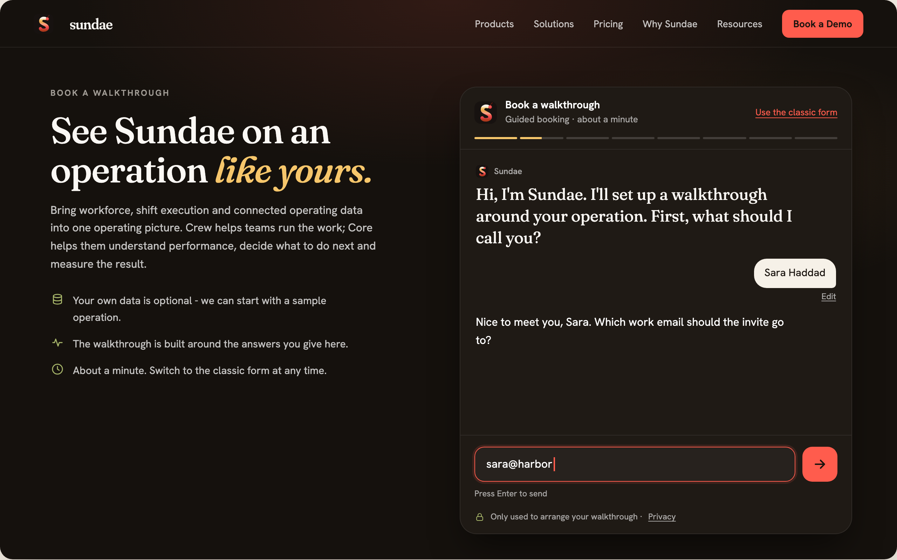
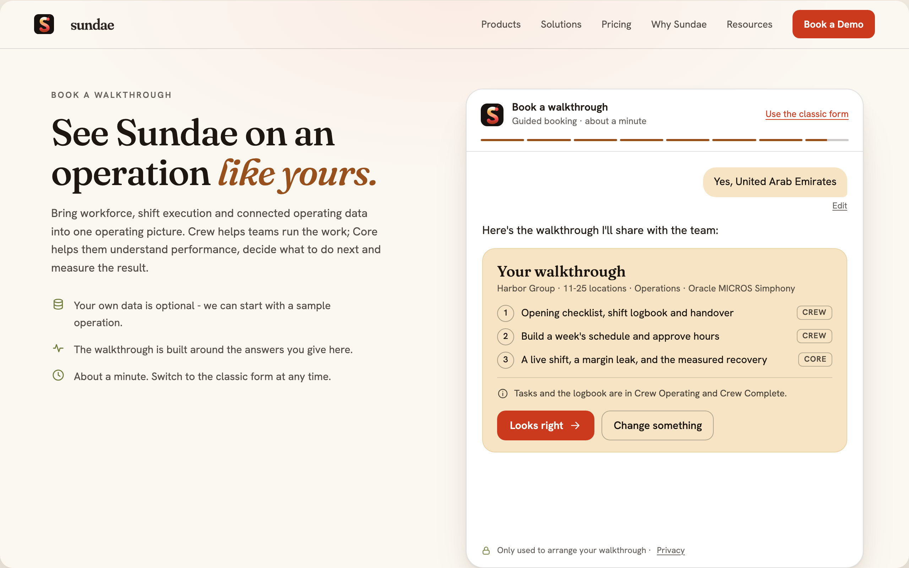
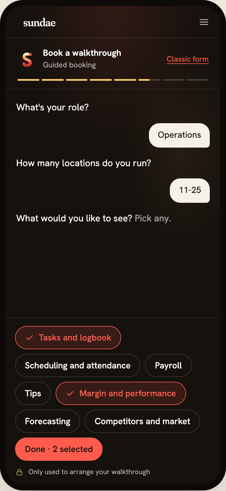
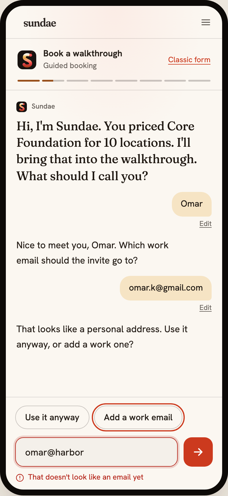
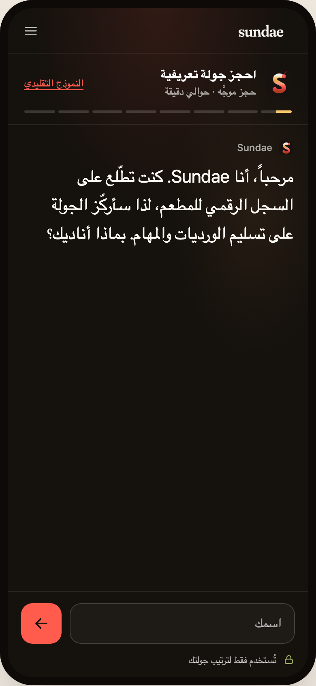
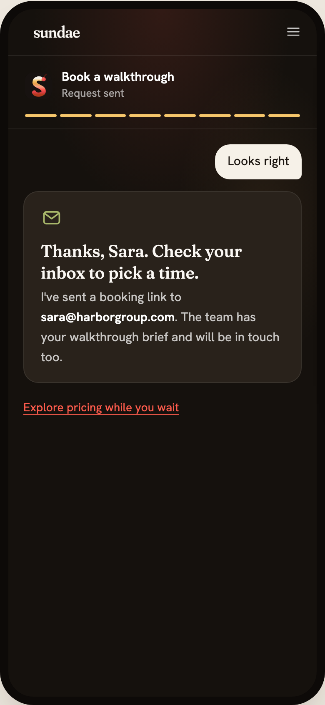
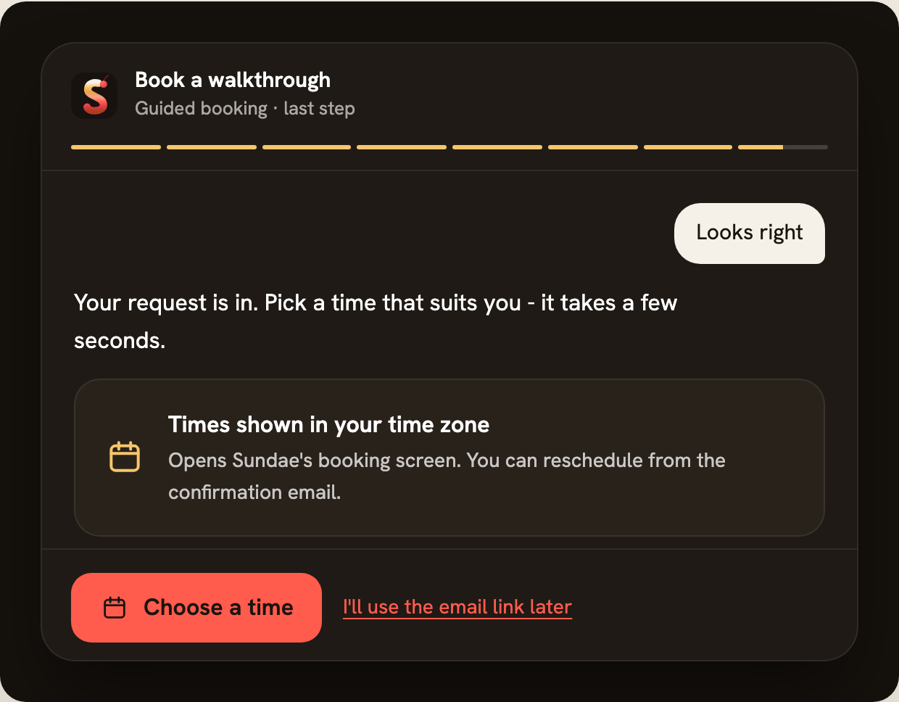
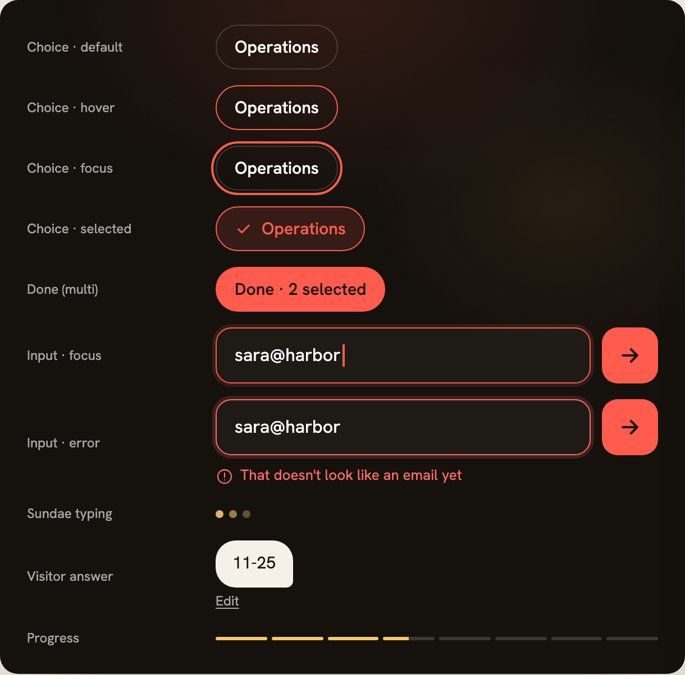
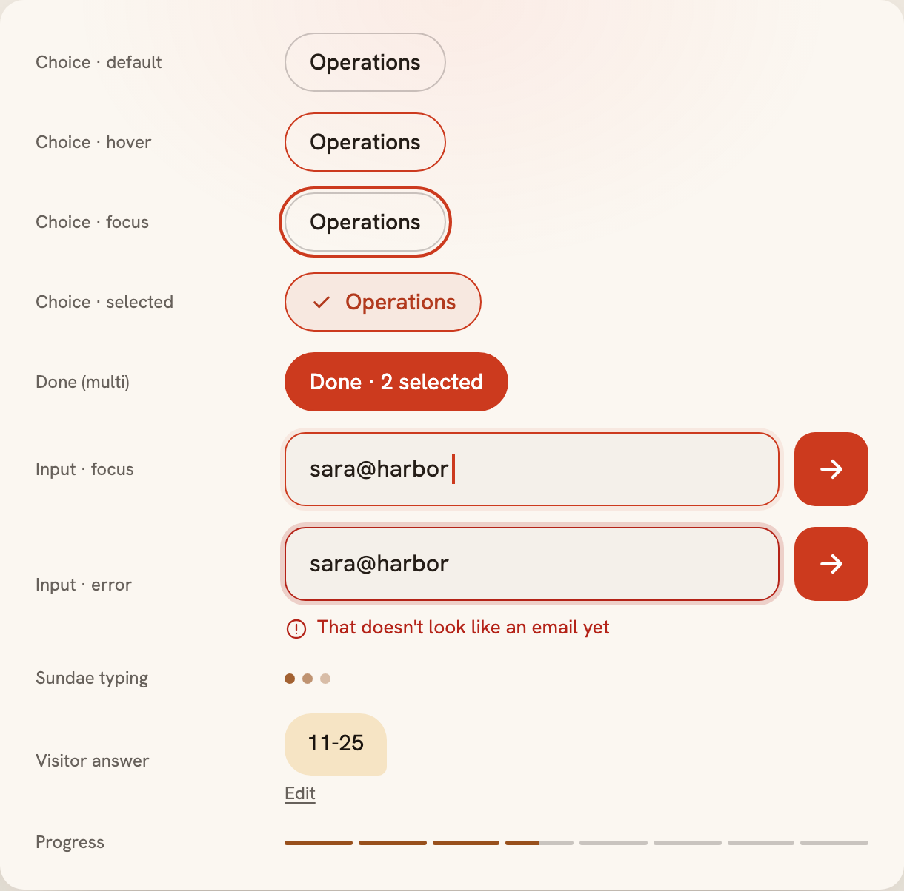

# Spec: conversational walkthrough booking

**For:** website team (`sundae-website`), with one backend change for the Sundae backend team in Phase 2 (`sundae-backend`, deployed as `Sundae-io/sundae-stable`).
**Status:** approved for build, 20 Nov 2026. Decisions D1-D4 are settled (section 10); section 12 is the build plan. Nothing built yet.
**Grounded in:** `sundae-website` `origin/main` at `62533b2` (20 Nov 2026; the files this spec depends on are unchanged since `f6edb98` apart from `src/app/book/loading.tsx`) and `sundae-backend` (`Sundae-io/sundae-stable`) `origin/develop` at `f314565` / `origin/main` at `f9fec55` (20 Nov 2026; the lead controller, booking controller and token service are unchanged since `266cc4f`).

---

## 1. Summary

Replace the static "Book a walkthrough" form with a short, scripted conversation in Sundae's voice. The visitor answers one question at a time by tapping a choice or typing a short reply. At the end they see a walkthrough brief built from their answers, and (Phase 2) they book a time on the spot instead of waiting for an email.

- **No AI and no credits.** Every line is pre-written and translated. Branching is deterministic.
- **No new lead pipeline.** It submits the same payload to the existing `/api/cta/submit` route, so the backend, admin lead inbox, auto-response email and notifications are unchanged.
- **Honest.** It's labelled as guided booking, never presented as a live person.
- **Reversible.** The classic form stays one click away and keeps any answers already given.

### Goals

1. More visitors who start the demo request finish it.
2. More finished requests turn into a booked meeting, sooner.
3. Better context for the sales call (focus areas, operating format) without making the visitor type more.
4. A pattern the Sundae app can reuse later for onboarding forms (Phase 3).

### Non-goals

- No LLM, chatbot or free-form question answering.
- No change to lead fields, lead storage, or admin triage.
- No change to pricing logic.
- Not a replacement for the Operations Diagnostic (`/diagnostic`), which has its own flow and AI report.

---

## 2. Current state (verified)

| Area | What exists | Where |
|---|---|---|
| Demo form | `LeadCaptureForm` (683 lines) used on `/demo`, `/contact`, `/get-started`. Props: `ctaLabel`, `reassurance`, `defaultMessage`, `className`, `pricingIntent`. | `src/components/marketing/LeadCaptureForm.tsx` |
| Fields | name, email, company, role (free text), country (select), countryCode, phone, numberOfLocations (8 buckets: `1`, `2-5`, `6-10`, `11-25`, `26-50`, `51-100`, `101-200`, `200+`), primaryPOS (free text), message (free text). Honeypot `website_url` (correctly hidden from assistive tech). | same |
| Context | `/demo` decodes `?cfg=` into `pricingIntent` (from the pricing calculator) and reads `?workflow=<key>` (e.g. `restaurant-logbook`) to set the default message. | `src/app/demo/page.tsx`, `src/lib/pricingIntent.ts` |
| Copy | Inline locale-keyed copy plus `src/generated-locales/components_marketing_LeadCaptureForm.ts`. | |
| Submit route | `POST /api/cta/submit`. Requires name, email, company, role, country, numberOfLocations, primaryPOS, message; phone required unless `isPhoneRequiredForLead()` exempts the source (today only `/diagnostic` and `diagnostic-call-request`). Accepts `metadata` (merged into the lead), `locale`, UTM fields, `Idempotency-Key` header. Rate limit 5 per IP per hour. | `src/app/api/cta/submit/route.ts`, `src/lib/leadValidation.ts` |
| Backend intake | `POST /api/v1/public/marketing/leads` (HMAC-signed). Idempotent. Returns `201 { ok, leadId, leadNumber }`. On a new lead, fires the auto-response email (with a booking link) and admin notifications. Records `ipCountry` from `cf-ipcountry` / `x-vercel-ip-country`. | `app/controllers/public_marketing_leads_controller.ts` |
| Booking token | `MarketingLeadBookingToken.signLeadToken(leadId, ttlDays = 30)` - stateless HMAC token granting "read slots and create one booking for this lead". Today it's only minted for the auto-response email link. | `app/services/marketing/marketing_lead_booking_token.ts`, `marketing_lead_email_service.ts` |
| Booking UI | `/book?token=` renders `BookingView` (1,420 lines): full-screen, light/dark, live slots, confirm/reschedule/cancel, 25 booking locales. Website proxies `/api/book/context`, `/api/book/slots`, `/api/book` (POST, 10 per IP per hour). Covered by `tests/booking-e2e/*`. | `src/app/book/*`, `src/app/api/book/*`, `src/lib/sundaeBookingClient.ts` |
| Analytics | PostHog `trackEvent`: `lead_form_started`, `lead_form_submit_attempted`, `lead_form_validation_failed`, `lead_form_submitted`, `lead_form_submission_failed`. | `src/lib/posthog` |

Gaps this spec addresses: 10 required inputs including phone and a free-text box; no use of the page or pricing context beyond a default message; after submitting, the visitor is told to check their inbox and wait "2-3 business days"; no step-level drop-off data.

---

## 3. Experience

### 3.1 Entry and layout

- Replaces the form card on all three lead forms - `/demo`, `/contact` and `/get-started` (and their locale versions) - behind the split in section 6.6. Each page passes a `mode`:
  - `demo` (`/demo`): the script in 3.3.
  - `get-started` (`/get-started`): same script; the opening uses the pricing intent when present (the page already decodes it).
  - `contact` (`/contact`): step 6 becomes "What's this about?" with choices Book a walkthrough, A pricing question, Partnership, Something else; "Book a walkthrough" continues with the demo focus chips, the others ask for a short message (stored in `message`). The brief card is replaced by a short summary ("Here's what I'll send the team"); the ending says the team will reply, and inline booking is offered only when "Book a walkthrough" was chosen. Product support questions get a link to support instead of a lead.
- Header strip: Sundae mark, "Book a walkthrough", subline "Guided booking · about a minute", and a text button **Use the classic form**.
- A message log (Sundae messages left, visitor answers right), then the answer area (choices or one input), then a quiet progress line ("Step 3 of 8").
- Desktop: the conversation sits where the form sits today (max width ~640 px). Mobile: full width; the answer area stays above the keyboard; no sticky elements over the log.
- Visual: the website's existing tokens (warm-coral accent, Fraunces for Sundae's lines is optional, Hanken Grotesk for UI). Must look right in dark and light themes and in RTL.

### 3.2 Opening lines (context-aware)

Pick the first matching rule:

| Context | Detected from | Opening (EN) | Preselected |
|---|---|---|---|
| Pricing estimate | `pricingIntent` present | "Hi, I'm Sundae. You priced {package} for {n} locations. I'll bring that estimate into the walkthrough. What should I call you?" | locations, focus from layer (Core / Crew / both) |
| Workflow page | `?workflow=` key | "Hi, I'm Sundae. You were looking at {workflow title}, so I'll centre the walkthrough on it. What should I call you?" | matching focus chip |
| Default | none | "Hi, I'm Sundae. I'll set up a walkthrough around your operation. First, what should I call you?" | none |

"I'm Sundae" refers to the product speaking, not a person. Never use a human name or a photo.

### 3.3 Conversation script (Phase 1)

Every step maps to an existing payload field. Values are stored exactly as the classic form stores them so the backend and admin views see no difference.

| # | Sundae asks (EN) | Answer UI | Stored as | Validation / branching |
|---|---|---|---|---|
| 1 | Opening line (3.2) | Text input "Your name" | `name` | 2+ characters |
| 2 | "Nice to meet you, {first name}. Which work email should the invite go to?" | Email input | `email` | Same regex as `/api/cta/submit`. If the domain is a free-mail provider (gmail, hotmail, outlook, live, yahoo, icloud, proton), ask "That looks like a personal address. Use it anyway, or add a work one?" with two choices. |
| 3 | "Are you with **{Company from domain}**?" (only if a work domain) else "What's the company or group called?" | Yes / Different name, or text input | `company` | Domain-to-name: take the label before the public suffix, title-case it. "Different name" opens a text input. |
| 4 | "What's your role?" | Choices: Owner or CEO, Operations, Finance, HR and people, Tech and data, Other (opens text) | `role` (choice label in English, see 3.6) | |
| 5 | "How many locations do you run?" (skipped if `pricingIntent` has locations: "I've got {n} locations from your estimate.") | Choices matching the 8 existing buckets | `numberOfLocations` (`1`, `2-5`, … `200+`) | |
| 6 | "What would you like to see? Pick any." | Multi-select chips (see 3.4) + Done | `metadata.convo.focus[]` | At least one |
| 7 | "Which POS do you use? Your own data is optional; we can start with a sample operation like yours." | Choices from the integrations list most relevant to the visitor's country, plus "Other" (text) and "Not sure" | `primaryPOS` | "Not sure" is stored as `Not sure` |
| 8 | "Looks like you're in **{country}**. Right?" | Yes / Somewhere else (opens the existing country select) | `country`, `countryCode` | Suggested country comes from the request's `x-vercel-ip-country` header (read server-side in `/demo/page.tsx` and passed as a prop). If absent, ask directly with the country select. |
| 9 | Walkthrough brief (3.5), then "Want a phone number on file for a reminder? It's optional." | Text input with dial code, or "No thanks" | `phone` | Optional if decision D1 is accepted; otherwise required with the existing message. |
| 10 | Submit, then Phase 1 ending or Phase 2 booking (3.7) | | | |

`message` (required by the route) is composed automatically: `"Walkthrough focus: {focus list}. Source: guided booking ({context})."` The visitor is never asked for free text, but step 6 includes an "Anything else?" text option for those who want it, appended to `message`.

Keyboard and edit behaviour:
- Enter submits the current input. Choices are buttons in tab order.
- Each visitor answer bubble has an **Edit** affordance that rewinds to that step, keeping later answers where still valid.
- **Back** rewinds one step.

### 3.4 Focus chips and how they map

| Chip (EN) | Brief line | Package note (only if selected) |
|---|---|---|
| Scheduling and attendance | Build a week's schedule and approve hours (Crew) | |
| Payroll | Preview a pay cycle for your country (Crew) | "Payroll availability is confirmed for your country before setup." |
| Tasks and logbook | Opening checklist, shift logbook and handover (Crew) | "Tasks and the logbook are in Crew Operating and Crew Complete." |
| Tips | Tip rules through to payroll handoff (Crew) | "Tip workflows are in Crew Operating and Crew Complete, or with Crew Payroll." |
| Margin and performance | A live shift, a margin leak, and the measured recovery (Core) | |
| Forecasting | The next 14 days and one what-if (Core) | "Foresight is included in Core Performance and available with the other packages." |
| Competitors and market | Competitor and local event signals (Core, Watchtower) | "Watchtower is available with Core Growth and Core Performance." |

Package facts come from catalogue v1.8.2 and the entitlement files (see the review's section 0). Keep them in one shared constants file so the brief, the site and the calculator can't drift.

### 3.5 Walkthrough brief

Shown as a card inside the log before submitting:

- Line 1: `{company} · {locations} locations · {role}`
- Numbered agenda from the selected focus chips (order: Crew items first, then Core).
- Package notes (3.4) for selected chips.
- "POS: {pos} · {country}".
- Two actions: **Looks right** (submits) and **Change something** (rewinds to step 6).

The brief is also stored in `metadata.convo.brief` so the sales team sees the same agenda in the admin lead view.

### 3.6 Localisation

- All Sundae lines, chip labels, errors and the brief go through the same locale pipeline as `LeadCaptureForm` (`generated-locales`), for every locale the website serves, with RTL layout for Arabic and Urdu.
- Store machine values, not translated labels: role and focus are stored as stable English keys (`owner_ceo`, `tasks_logbook` …) in `metadata.convo`, and as the English label in `role`, so admin views and reporting don't depend on the visitor's language.
- Country names in the "Somewhere else" select must be localised (the current Arabic demo form lists them in English; fix that here).

### 3.7 Ending

**Phase 1 (no backend change).** After a successful submit:
- "Thanks, {first name}. I've sent a link to {email} so you can pick a time. You'll also hear from the team." (The existing auto-response email already carries the booking link, valid 30 days.)
- Secondary: "Explore pricing while you wait".

**Phase 2 (inline booking).** After a successful submit that returns a `bookingToken`:
- "Pick a time that suits you" with a single **Choose a time** button that opens the existing `BookingView` full-screen with that token (no new slot picker). On close or completion, return to the conversation with a confirmation line.
- If no token is returned (personal email, duplicate lead, error), fall back to the Phase 1 ending.

### 3.8 Classic form switch and resume

- **Use the classic form** swaps to `LeadCaptureForm` prefilled with answers so far (add an `initialValues` prop).
- Progress is saved to `sessionStorage` under `sundae_convo_demo_v1` (answers only, no tokens), so a refresh resumes. Cleared on successful submit.

---

## 3A. Visual design

**Design reference board:** [`design/guided-booking-design-reference.html`](design/guided-booking-design-reference.html) - open it in a browser. It contains principles, the token map, seven key screens, every component state in both themes, measurements, motion rules and a clickable prototype using the same styles. Brand mark and wordmark in `design/assets/` are copies of the current `public/brand/` assets (the 18 Nov identity change plus the 19 Nov symbol restore).

**Use the website's existing tokens only** (`src/styles/tokens.css`) and follow `docs/COLOR_SYSTEM.md`:

| Role in this flow | Token (dark / light) | Why |
|---|---|---|
| Send button, selected choices, focus ring, final primary action | `--warm-coral` #FF5C4D with ink text / `--accent-warm` #CC3A1E with white text | Coral is rationed to action. Ink on coral is 6.0:1; white on coral would be 3.1:1, so never use white text on #FF5C4D. |
| Selected choice text on its tint | coral / `--action-on-tint` #B23A1E | 4.7:1 and 5.3:1. |
| Visitor's answers | `--cream` with `--ink` text, both themes | Cream is the "human moment" surface; the visitor's words are the human part of the conversation. |
| Progress | `--text-warm` (#F6C66B / #98501C) | Warmth, "act in time", keeps coral free. |
| Privacy and reassurance icons | `--trust` olive | Trust surfaces and iconography. |
| Sundae's first line | Fraunces, `--text-display` | Editorial voice, not a chatbot bubble. |
| Eyebrow | `.eyebrow` (`--eyebrow`) | Muted; never coral. |

### Key screens

**Desktop, dark - opening and email step**

**Desktop, light - walkthrough brief before submitting**

**Phone, dark - multi-select focus** · **Phone, light - personal email prompt with focus and error states** · **Phone, dark - Arabic (RTL)** · **Phone, dark - Phase 1 ending**

**Phase 2 - hand-off to the existing booking screen**

**Component states (dark and light)**

### What makes it feel premium (implement these, not decoration)

1. **Typography carries Sundae's voice.** The first Sundae line is set in Fraunces at headline size; later lines are plain body text with no bubble. Only the visitor's answers are bubbles. This is the main thing that separates it from a generic chat widget.
2. **One decision on screen.** The answer area holds a single input or one set of choices, pinned to the bottom of the panel; the log scrolls above it.
3. **The brief as a reward.** The cream "Your walkthrough" card (Fraunces title, numbered agenda, neutral Crew/Core tags, accurate package notes) is the payoff for answering - give it the most care.
4. **Restraint in colour and motion.** Coral appears in at most two places at once. Motion is short (160-240 ms), never bouncy, and disappears with reduced motion.
5. **Quiet trust cues.** The olive lock line ("Only used to arrange your walkthrough · Privacy") and the left-column reassurance rows answer "what happens to my details?" without a modal.

### Measurements and motion

Exact sizes, radii, type styles and motion timings are in sections 4 and 5 of the board. Highlights: panel 560 px wide, radius 24; choices 40 px (44 on touch); input and send 50 px with 16 px text (avoids iOS zoom); typing indicator 250-400 ms maximum; new lines fade and rise 6 px over 180 ms.

### RTL and localisation details

Mirror with logical CSS properties, flip directional icons and the progress fill, keep "Sundae" in Latin script wrapped in `<bdi>`. Fraunces has no Arabic glyphs, so Arabic greetings use the body font at a larger size (the site currently falls back to system fonts for Arabic; adopting a dedicated Arabic web font is a separate, site-wide decision).

### Not decided by the board

The left-column headline on the board ("See Sundae on an operation like yours") was a placeholder; since 20 Nov the live `/demo` H1 is "See Sundae at work in your operation." - use that. All copy is English reference copy and must go through the locale pipeline.

---

## 4. Copy and voice rules

- Short, warm, plain. One question per message. No exclamation marks on system lines, no "please", no "simply".
- House style: spaced hyphen " - ", never an em dash; sentence case.
- Never claim to be a person, never fake long typing. A typing indicator of at most 400 ms, and none when `prefers-reduced-motion: reduce`.
- Don't promise outcomes or prices in the conversation. The pricing-context opening restates only what the visitor configured.

---

## 5. Accessibility (WCAG 2.2 AA)

- The message log is `role="log"` with `aria-live="polite"`; each new Sundae line is announced once.
- Every answer control is a real `<input>`, `<select>` or `<button>` with a visible or programmatic label matching the question. Choice chips that allow multiple selection use `aria-pressed`.
- `autocomplete` on name (`name`), email (`email`), organisation (`organization`), phone (`tel`) - closes the 1.3.5 gap the review found on the current form.
- Focus moves to the new answer control after each Sundae line; Edit and Back return focus sensibly.
- Errors are inline next to the control, announced, and never colour-only.
- Targets at least 24 × 24 px; contrast at least 4.5:1 in both themes (note the review's light-theme token issue, F09).
- Works at 320 px width and 200% zoom without horizontal scroll.
- The classic form remains available for anyone who prefers it.

---

## 6. Technical design

### 6.1 Components (website)

- `src/components/marketing/ConversationalLeadCapture.tsx` - the UI.
- `src/lib/leadConversation/` - pure logic, no React:
  - `script.ts` - ordered step definitions (id, prompt key, input kind, options, validator, `skipIf`, `store`).
  - `machine.ts` - `start(context)`, `answer(state, stepId, value)`, `back(state)`, `edit(state, stepId)`, `toPayload(state)`. Deterministic and unit-testable.
  - `inference.ts` - free-mail detection, company-from-domain, location-bucket mapping from `pricingIntent`.
  - `packageNotes.ts` - the shared package facts from 3.4.
- Extract field validators and option lists from `LeadCaptureForm` into `src/lib/leadFields.ts` so both forms share one source.
- Lazy-load the conversational component on `/demo` (no new dependencies).

### 6.2 Submission

- `POST /api/cta/submit` with the same body as the classic form plus:
  - `source: 'guided-booking'` and `ctaLabel` unchanged,
  - `metadata.convo = { version: 1, context: 'pricing'|'workflow'|'default', workflowKey?, focus: string[], brief: {...}, steps: number, durationMs }`.
- One `Idempotency-Key` generated when the conversation starts and reused on retry.
- Honeypot field kept, hidden the same way as today.
- Error handling: on 429/502 show the route's message in Sundae's voice with a Retry button; answers are kept.

### 6.3 Phone requirement (decision D1)

To make phone optional for this flow, extend `isPhoneRequiredForLead()` to exempt `source === 'guided-booking'`. If sales needs phone numbers, keep step 9 required and change its copy to "What's the best number to reach you?".

### 6.4 Phase 2 backend change (inline booking)

In `PublicMarketingLeadsController.create` (sundae-backend):
- When `created === true` **and** the request body carries `metadata.convo` **and** the email domain is not a free-mail provider, mint `MarketingLeadBookingToken.signLeadToken(leadId, ttlDays)` with a short TTL (recommend 2 hours, i.e. `2 / 24`) and return it as `bookingToken` in the 201 response.
- Do not return a token for duplicates (`created === false`) - those visitors already have the emailed link, and it prevents someone re-submitting another person's email to obtain a booking credential.
- The 30-day token in the auto-response email is unchanged.

In the website:
- `sundaeLeadClient.submitLeadToSundae` passes `bookingToken` through; `/api/cta/submit` returns it to the browser only for `source === 'guided-booking'`.
- The token is held in component memory only (never `sessionStorage`, never in a URL other than the `BookingView` hand-off, which already treats the token as a non-indexed, no-referrer credential).

Free-mail list (identical in website `inference.ts` and the backend helper; exact domain match, lower-cased): `gmail.com`, `googlemail.com`, `hotmail.com`, `hotmail.co.uk`, `hotmail.fr`, `outlook.com`, `live.com`, `msn.com`, `yahoo.com`, `yahoo.co.uk`, `ymail.com`, `icloud.com`, `me.com`, `mac.com`, `aol.com`, `proton.me`, `protonmail.com`, `gmx.com`, `gmx.de`, `yandex.com`, `mail.ru`, `qq.com`, `163.com`.

Response contract: the backend 201 body gains an optional `bookingToken: string`. The website submit route returns it to the browser as `bookingToken` only when `source === 'guided-booking'`; every other caller's response is unchanged.

Risk note: returning a token to the submitter loosens today's "only the inbox owner can book" property. Mitigations: work-email only, new leads only, 2-hour TTL, the existing 10-per-hour booking rate limit, and the booking confirmation email to the address (which carries cancel links). Decision D2 confirms this trade-off.

### 6.5 Analytics (PostHog)

Keep the existing `lead_form_*` events (with `variant: 'guided'`) so dashboards still work, and add:

| Event | Properties |
|---|---|
| `guided_booking_started` | context, workflowKey, locale |
| `guided_booking_step_answered` | stepId, stepIndex, inferred (bool), msSinceStart |
| `guided_booking_step_edited` | stepId |
| `guided_booking_switched_to_classic` | atStepId |
| `guided_booking_brief_shown` | focusCount |
| `guided_booking_submitted` | locations bucket, focus keys (no PII) |
| `guided_booking_booking_opened` / `_booked` (Phase 2) | |
| `guided_booking_abandoned` | lastStepId (sent on `pagehide`) |

No names, emails or phone numbers in event properties.

### 6.6 Experiment

**Split mechanism (decision D4): environment variable plus first-party cookie, no PostHog flag.**
- `NEXT_PUBLIC_GUIDED_BOOKING` (website env var) with values `off` (default when unset), `split` (50/50) or `on` (100% guided). Optional per-surface override `NEXT_PUBLIC_GUIDED_BOOKING_SURFACES` (comma list of `demo,contact,get-started`; default all three).
- In `split`, a visitor is assigned once and kept in that variant with a first-party cookie `sundae_lead_variant` (`guided` or `classic`, 90 days, `SameSite=Lax`, path `/`). The cookie is functional (it decides which form is shown), carries no personal data, and must not depend on analytics consent; assignment happens client-side so pages stay statically cacheable.
- `?guided=1` / `?guided=0` forces a variant for QA without changing the cookie.
- Every `lead_form_*` and `guided_booking_*` event carries `variant` and `surface`.
- Code ships with the variable unset, so merging changes nothing for visitors until the variable is set.

**Rollout (decision D3): all lead forms, gated by results.**
1. Merge with the variable unset (`off`). Verify on a preview deployment with `?guided=1`.
2. Set `split` on all three surfaces.
3. After at least 2 weeks **and** at least 40 started requests per variant per surface (whichever comes later), compare. Promote a surface to `on` only if all hold:
   - guided completion rate (`lead_form_submitted` / started) is not lower than classic;
   - guided submission-error rate is not higher than classic;
   - no open accessibility or localisation defects, and no rise in spam or duplicates in the admin lead inbox.
4. If a surface fails, set it back to classic (`NEXT_PUBLIC_GUIDED_BOOKING_SURFACES` without it) and fix before re-testing.
5. If guided completion drops by 10 percentage points or more at any point, switch to `off` immediately.
- Exclude internal traffic (`?qa=1`, Sundae office IPs) before reading results. The owner reads the results in PostHog (named at launch).

---

## 7. Phases

| Phase | Scope | Repos | Depends on |
|---|---|---|---|
| 1 | Conversation, brief, submit via existing route, Phase 1 ending, classic switch, resume, analytics, experiment flag, localisation | sundae-website | D1 |
| 2 | Inline booking via short-TTL lead token and the existing `BookingView` | sundae-backend + sundae-website | D2, Phase 1 results |
| 3 | Reuse in the Sundae app: a conversational renderer for existing schema-defined forms (RJSF + Zod), starting with one onboarding form; same accessibility and localisation rules; option to hand off to a person ("Want us to do this with you on a call?") | sundae-app | Phase 1 learnings |

Phase 3 should render the same schema either as the classic form or as a conversation, so each form is defined once and validation is shared. It must meet the app's own rules (all 25 registered locales, `useScopeId` for anything scope-aware, the automated QA gates).

---

## 8. Acceptance criteria

Phase 1:
1. With `NEXT_PUBLIC_GUIDED_BOOKING` unset nothing changes; with `on` (or `?guided=1`) `/demo`, `/contact` and `/get-started` show the conversation in their `mode`; with `split` a visitor stays in one variant across visits (cookie). Both variants submit successfully on every surface.
2. A completed conversation produces a lead whose stored fields match what the classic form would store for the same answers, plus `metadata.convo`.
3. Opening line changes correctly for default, each `?workflow=` key, and a decoded `?cfg=`; locations are skipped when known from `cfg`.
4. Free-mail email triggers the "personal address" choice; work email prefills the company question.
5. Country is suggested from `x-vercel-ip-country` and can be changed.
6. Edit, Back, refresh-resume and **Use the classic form** (with answers carried over) all work.
7. No step blocks progress without an inline, announced error.
8. axe reports no violations for the component in dark and light at 1440 and 390; keyboard-only completion works; reduced motion removes the typing delay.
9. Renders correctly at 320, 390, 768, 1280 and 1440 px and in Arabic (RTL) and German.
10. Every visible string is localised for every locale the website serves; country names are localised.
11. Events in 6.5 fire with no PII.
12. Submitting with all non-GET requests blocked except the submit route still produces exactly one lead (idempotency key reused on retry).

Phase 2:
13. A new lead with a work email receives `bookingToken`; a duplicate or free-mail lead does not.
14. **Choose a time** opens `BookingView` with the token; a booking can be completed, and the conversation shows the confirmation afterwards.
15. The token never appears in `sessionStorage`, logs, analytics or the page URL outside the booking hand-off; it expires after the agreed TTL.

---

## 9. Test plan

- Unit tests for `machine.ts`, `inference.ts` and `toPayload` (every branch in 3.3, including skips and edits).
- Playwright flow spec under the website's tests: golden path (default context), pricing-context path, personal-email path, switch-to-classic, refresh-resume. Reuse `tests/booking-e2e/backend-fixture.mjs` for Phase 2 booking.
- Accessibility: axe on the component in both themes; manual keyboard pass; one screen-reader pass (VoiceOver) before launch.
- Visual: 320/390/768/1280/1440, dark and light, EN/AR/DE.

---

## 10. Decisions (settled 20 Nov 2026 by the owner)

| ID | Decision | Outcome |
|---|---|---|
| D1 | Phone in the guided flow | **Optional.** Asked after the brief as a reminder number. Extend `isPhoneRequiredForLead()` to exempt `source === 'guided-booking'`. The classic form is unchanged. |
| D2 | Inline booking (Phase 2) | **Yes, with limits:** short-lived token (2 hours), new leads only, work-email domains only; the 30-day emailed link is unchanged. Built in parallel in the backend. |
| D3 | Rollout surfaces | **All lead forms** (`/demo`, `/contact`, `/get-started`), each kept only if it is effective and causes no problems - see the go/no-go rules in 6.6. |
| D4 | Split mechanism | **Environment variable plus first-party cookie** (6.6). No PostHog flag. |

Still to name before switching to `split`: who reads the results in PostHog.

---

## 11. Out of scope

- Any AI-generated replies or summaries.
- Changes to the auto-response email, admin lead views, or CRM.
- Pricing changes.
- The Operations Diagnostic flow.
- Phase 3 (the Sundae app) - a separate piece of work after the website results are in.

---

## 12. Build plan (20 Nov 2026)

Two workstreams run in parallel. Neither merges or deploys to production without the owner's explicit go-ahead.

### A. Website (`sundae-website`, GitHub `roblaryea/sundae-website`)

- **Branch:** a new branch cut from the latest `origin/main` in its own worktree. Never reset, rebase or push the local `main` checkout (it is 162 commits behind and has 2 unpushed commits of its own). Website fixes from the 17 Nov review are being merged to `main` in parallel (PRs #272 onward), so rebase on `origin/main` before opening the PR and keep changes confined to the files below.
- **Files expected:** new `src/components/marketing/ConversationalLeadCapture.tsx`, new `src/lib/leadConversation/` (`script.ts`, `machine.ts`, `inference.ts`, `packageNotes.ts`, `variant.ts`), new `src/lib/leadFields.ts` (shared field options and validators extracted from `LeadCaptureForm`), small changes to `LeadCaptureForm.tsx` (`initialValues` prop, use `leadFields`), `src/app/demo/page.tsx`, `src/app/contact/page.tsx`, `src/app/get-started/page.tsx` (read `x-vercel-ip-country`, render the variant), `src/lib/leadValidation.ts` (D1), `src/app/api/cta/submit/route.ts` (pass through `bookingToken` for `source === 'guided-booking'` when present), `src/lib/sundaeLeadClient.ts` (read `bookingToken`), locale copy through the existing generated-locales pipeline, tests.
- **Phase 2 on the website:** feature-detect `bookingToken` in the submit response. When present, offer **Choose a time**, which opens the existing `BookingView` with the token; when absent, use the Phase 1 ending. This lets the website ship before the backend change reaches production.
- **Localisation:** every string for all 22 website locales (`websiteLocales` in `src/lib/i18n.ts`), RTL for Arabic and Urdu, localised country names; must pass `qa:i18n` and `qa:translation`.
- **Checks before the PR:** `npm run lint`, `npm run qa:i18n`, `npm run qa:translation`, `npm run qa:page-copy`, `npm run test:seo`, `npm run qa:reduced-motion`, `npm run qa:fixed-position`, `npm run build` (the same steps as `.github/workflows/quality-gates.yml`); new unit tests (`node --test`) for the state machine, inference and payload; a Playwright flow spec covering the paths in section 9; axe on the component in both themes at 1440 and 390; screenshots at 320/390/768/1280/1440, dark and light, EN/AR/DE compared against the design board.
- **Never** submit a real lead to production while testing: block non-GET requests or use a preview deployment pointed at the dev backend.
- **Done when:** a PR to `main` is open with the checks green, the acceptance criteria in section 8 (1-12, plus 14-15 against a backend fixture) are demonstrated with screenshots, and `NEXT_PUBLIC_GUIDED_BOOKING` is unset so merging changes nothing for visitors.

### B. Backend (`sundae-backend`, GitHub `Sundae-io/sundae-stable`)

- **Branch:** a new branch cut from the latest `origin/develop` in its own worktree. The local checkout has uncommitted work on another branch; do not touch it. `develop` is protected (PR, required checks, squash merge).
- **Change:** in `PublicMarketingLeadsController.create`, when `created === true`, `body.metadata?.convo` is present and the email domain is not a free-mail provider, add `bookingToken: MarketingLeadBookingToken.signLeadToken(String(lead.id), 2 / 24)` to the 201 response. Nothing else changes (no new routes, so no API-inventory update; the auto-response email and its 30-day link are untouched). Put the free-mail list in one shared helper.
- **Tests:** unit tests for the token conditions (new lead + work email → token; duplicate → none; free-mail → none; no `convo` → none) and that the token verifies and expires after 2 hours. Never run the test suite against the dev database: `node ace test` deletes data on whatever `DATABASE_URL` points at. Use a local throwaway database with a sanitised `.env`, one spec at a time.
- **Checks before the PR:** `npx eslint` on changed files (CI's gate), typecheck, the new tests.
- **Done when:** a PR to `develop` is open with checks green. Promotion to production follows the normal `develop` → `main` release PR, only with the owner's go-ahead.

### Launch sequence (owner approves each step)

1. Merge the backend PR to `develop`; verify on dev that a guided submission returns a token and inline booking works end to end on a website preview pointed at the dev backend.
2. Merge the website PR to `main` with the variable unset (no visible change).
3. Release the backend change to production.
4. Set `NEXT_PUBLIC_GUIDED_BOOKING=split` on the website's Vercel production environment and redeploy.
5. Read results per 6.6; promote, hold or roll back each surface.
